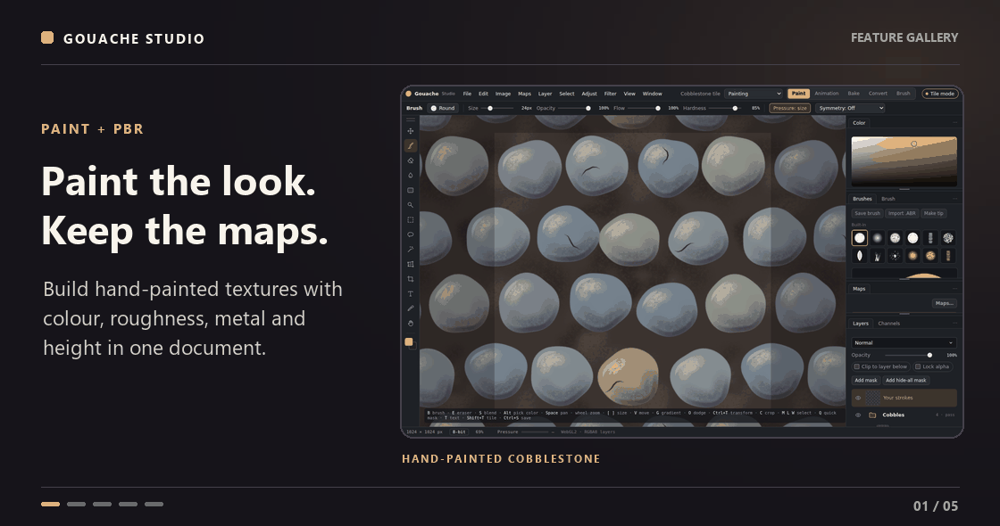

# Gouache Studio

Gouache Studio is a GPU-accelerated app for digital painting, 3D texturing, and game art. Paint on a canvas or directly on a model, bake mesh maps, build reusable materials, and export textures for your engine. It runs as a self-updating Windows app or as a browser build.

**[Download Gouache Studio for Windows (x64)][windows-download]**

[Other installers and release notes](https://github.com/Kenn0090/gouache-studio/releases/latest) · [User guide](docs/wiki/Home.md) · [Version history](CHANGELOG.md)

## Feature gallery

<picture>
  <source media="(prefers-reduced-motion: reduce)" srcset="docs/showcase/gouache-gallery-poster.jpg">
  
</picture>

<details>
<summary>Explore the five featured workflows</summary>

- [Paint the look. Keep the maps.](docs/wiki/Maps-and-PBR.md) Paint colour, roughness, metallic and height in the same document.
- [Paint right on the model.](docs/wiki/3D-Paint.md) Switch between the UV texture and the model in one project, with texture sets and UDIM tiles.
- [Wear that follows the mesh.](docs/wiki/Smart-materials-and-anchors.md) Use baked curvature and ambient occlusion to place wear and dirt, and save the layers as reusable smart materials.
- [Fix the bake on the surface.](docs/wiki/Baker.md) Paint skew and offset corrections on the model while checking a high-to-low bake.
- [Build VFX flipbooks.](docs/wiki/Animation.md) Generate stylized effects, edit the frames, and export a sprite sheet.

</details>

## Download

The download above starts the recommended **Full installer**. It includes the bundled materials, skies, and grunge maps. The [release page](https://github.com/Kenn0090/gouache-studio/releases/latest) lists the smaller **Lite installer** and the **MSI** when available.

Already installed? Use **File → Check for updates…**. See [Getting started](docs/wiki/Getting-started.md) for installation and your first project.

## What you can do

| Workflow | Features |
| --- | --- |
| **Paint and illustrate** | Use pressure-sensitive brushes, import Photoshop brushes, make custom tips, and work with layers, masks, selections, paths, gradients, live filters, and non-destructive crop. Open and export layered PSDs. [Painting guide](docs/wiki/Brushes-and-painting.md) |
| **Paint on a 3D model** | Import OBJ, glTF, GLB, or binary or text FBX. Cancel a large import from the progress bar. Paint PBR channels with per-material texture sets and UDIM tiles, polygon fill, surface paths, symmetry, stencils, and decals. Use **Ctrl + left-drag** to smooth painted areas and **M** to return to Material Lit. [3D Paint guide](docs/wiki/3D-Paint.md) |
| **Build materials and masks** | Layer material channels, project textures in UV, planar, or triplanar space, and build smart materials and masks with generators, baked maps, custom grunge, and anchor points. Browse ambientCG materials and textures from the app. [Materials and masks](docs/wiki/Smart-materials-and-anchors.md) · [Online library](docs/wiki/Online-library.md) |
| **Bake, convert, and preview** | Bake normals, ambient occlusion, curvature, thickness, ID, and other maps from a model. Use a cage and paint skew or offset corrections, unwrap UVs, and convert images into texture maps. Inspect materials under HDRI lighting or in the ray-traced viewer, and capture stills or turntables. [Baker](docs/wiki/Baker.md) · [Convert](docs/wiki/Convert-tab.md) · [Viewer](docs/wiki/New-viewer.md) |
| **Animate and edit photos** | Create frame animations, flipbooks, and sprite sheets. Edit JPEG and RAW photos with masks, curves, colour adjustments, and presets. Optional AI add-ons include selection, removal, and upscaling. [Animation](docs/wiki/Animation.md) · [Photo](docs/wiki/Photo-tab.md) · [AI add-ons](docs/wiki/AI-add-ons.md) |
| **Export and automate** | Pack texture channels and export models and maps for Unreal, Unity, Godot, Blender, or Roblox Studio. Use the two-way links for Blender, Unity, and Unreal to bring model or material changes back into Gouache. Record or write scripts for repeatable workflows. [Files and export](docs/wiki/Files-and-export.md) · [Scripting](docs/wiki/Scripting.md) |

See the [latest release notes](https://github.com/Kenn0090/gouache-studio/releases/latest) for recent changes and the [changelog](CHANGELOG.md) for the full history.

## Build from source

```sh
npm ci
npm run build:web      # Browser build in dist-web/
npm run desktop:build  # Windows installer; requires Rust and Tauri prerequisites
```

The application source is in [src/js](src/js), with its load order in [src/js/order.json](src/js/order.json). The Windows shell, file access, and updater are in [src-tauri](src-tauri). See the [test guide](tests/e2e/README.md) and the [release workflow](AGENTS.md) for development and publishing.

[windows-download]: https://github.com/Kenn0090/gouache-studio/releases/download/v0.97.4/Gouache.Studio_0.97.4_x64-setup.exe
