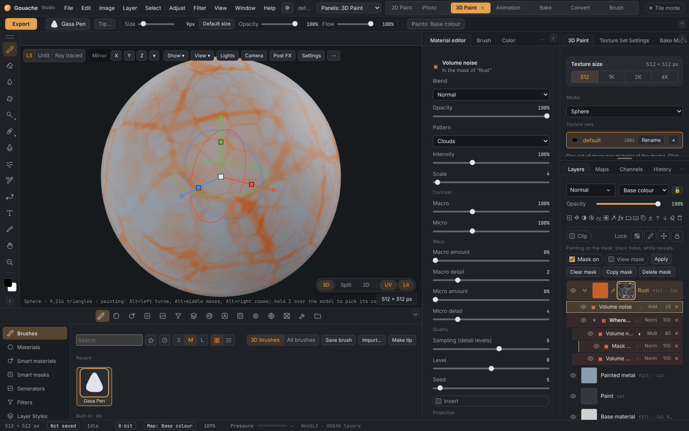
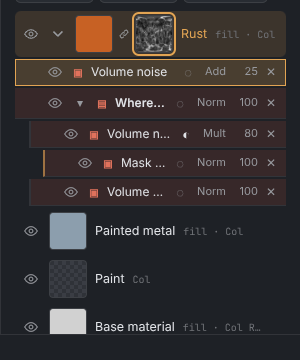
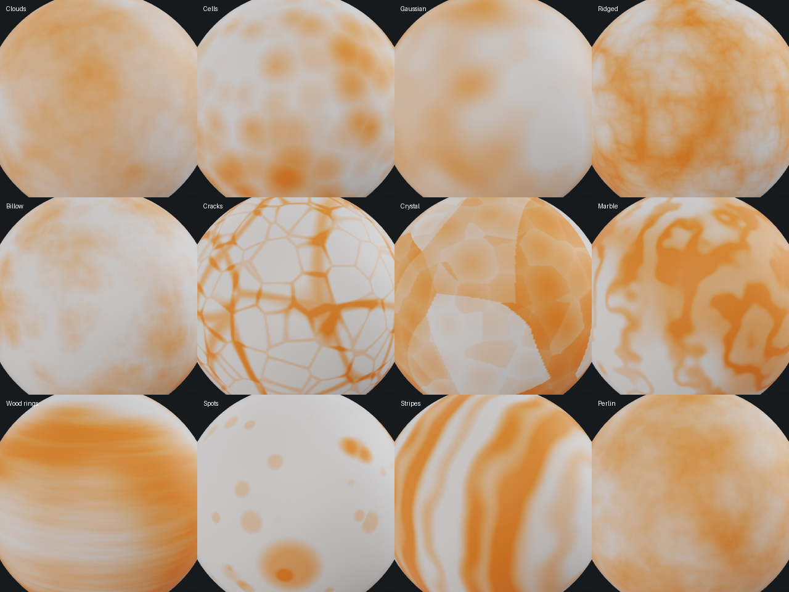

# Gouache Studio

**A GPU painting and texture app for game art.** Paint on a canvas or straight onto a 3D model, keep every PBR map in step, bake from a high-poly, build reusable materials and masks, and send the result to your engine.

Gouache Studio is a desktop app for Windows (it updates itself) and also runs in a web browser. It is built with plain JavaScript and WebGL on [Tauri](https://tauri.app).

**[Download Gouache Studio for Windows (x64)][windows-download]**

[Other installers and release notes](https://github.com/Kenn0090/gouache-studio/releases/latest) · [User guide](docs/wiki/Home.md) · [Version history](CHANGELOG.md)



## The tabs

| Tab | What it is for |
| --- | --- |
| **2D Paint** | A layered painter in the style of Photoshop: pressure-sensitive brushes, layers, groups and masks, selections, transforms, paths, shapes, live filters, Photoshop file import and export. Every layer carries all the PBR maps. |
| **3D Paint** | Paint on an imported model (OBJ, glTF, FBX). One texture set per material, UDIM tiles, mirror and radial painting, stencils, decals, polygon fill, a layer stack with fill layers and masks like Substance Painter. |
| **Bake** | A GPU baker with a search tree for models of millions of triangles. Normal, ambient occlusion, curvature, thickness, position, ID and lighting maps, a cage with painted skew and offset fixes, and bake groups. |
| **Convert** | Make normal, height, curvature, AO and other maps from a photo or from each other. |
| **Photo** | Develop JPEG and RAW photos: light, colour, curves, local masks, spot removal, crop, presets. |
| **Animation** | Frame animation, flipbooks and sprite sheets, with stylised effect filters. |
| **Brush** | A canvas of its own for drawing brush tips. |

## What is in it

**Maps and materials.** Base colour, roughness, metallic, height, normal, ambient occlusion, emissive, opacity, curvature, subsurface and translucency, plus channels of your own. Metal/rough or spec/gloss workflow. Fill layers hold a whole material, with pictures or values per channel, and project in UV, planar, spherical or triplanar space. A material library of ambientCG scans and a set of Poly Haven skies come with the app, and more can be downloaded.

**Masks that follow the model.** A mask is a stack of rows: paint, fills, mesh maps, noise, generators (edge wear, dirt, dust, moss, rust and more), filters and other layers. Rows can sit in folders and each row can have a mask stack of its own, as deep as you like. The generators read the baked curvature and ambient occlusion and have controls for big, medium and small shapes. A volume noise row fills 3D space with twelve kinds of pattern (clouds, cells, ridged, cracks, marble, wood rings, Perlin and more), so it never shows a seam. Whole masks and whole folders of layers can be saved as smart masks and smart materials.





**3D viewing.** HDRI lighting, per-material shaders (standard, skin with subsurface blur, anisotropic metal, velvet, toon, cel, hologram, glass, fur and others), a progressive ray-traced view, screenshots, turntable video and a render window.

**When the model changes.** Update the model file or use **Replace the model, keep my paint**: the paint is moved onto the new UVs by surface position, also across a different triangle layout. **Transfer paint from another project** brings the paint of a saved project onto the current model.

**Export and automation.**

- Texture export with presets for Unreal, Unity, Godot, Blender and Roblox, packed channels of your own, and PNG, TGA, TIFF, DDS, WebP, BMP or JPG.
- Model export with textures hooked up, and engine shaders for the viewer looks.
- Two-way links with Blender, Unity and Unreal.
- JavaScript scripting with a recorder, inside the app.

**Safety and speed.** Autosave and a recovery list, undo that spills to disk, a painting report that shows where time goes, drawing in tiles so the graphics card is never kept busy for long, and a memory limit that follows your card.

## Download and install

The download above is the recommended **Full installer**, with the bundled materials, skies and grunge maps. The [release page](https://github.com/Kenn0090/gouache-studio/releases/latest) also lists a smaller **Lite installer** (the content is downloaded on first start) and an **MSI**.

The Windows installer is not code-signed, so Windows may show a warning the first time. Already installed? Use **File → Check for updates…**. See [Getting started](docs/wiki/Getting-started.md) for your first project, and [Troubleshooting](docs/wiki/Troubleshooting.md) if something goes wrong.

## Learn more

- [User guide](docs/wiki/Home.md): every tab and feature, with screenshots
- [Keyboard shortcuts](docs/wiki/Keyboard-shortcuts.md)
- [Version history](CHANGELOG.md)
- [Content and credits](docs/wiki/Textures-and-decals.md): who made the materials, skies and grunge maps

## Build from source

```sh
npm ci
npm run build:web      # Browser build in dist-web/
npm run desktop:build  # Windows installer; requires Rust and Tauri prerequisites
```

The application source is in [src/js](src/js), with its load order in [src/js/order.json](src/js/order.json). The Windows shell, file access and updater are in [src-tauri](src-tauri). Tests run in a real browser and check pixels: see the [test guide](tests/e2e/README.md). How releases are made is in [AGENTS.md](AGENTS.md), and [CONTRIBUTING.md](CONTRIBUTING.md) says how to help.

## About

Gouache Studio is made by Kenn ([@Kenn0090](https://github.com/Kenn0090)), with the AI coding assistants Claude and Codex writing and testing much of the code under Kenn's direction.

**Licence:** the source is public so you can read it and follow along, but no open-source licence has been chosen yet. Until one is added, please ask before reusing the code.

[windows-download]: https://github.com/Kenn0090/gouache-studio/releases/download/v0.98.16/Gouache.Studio_0.98.16_x64-setup.exe
