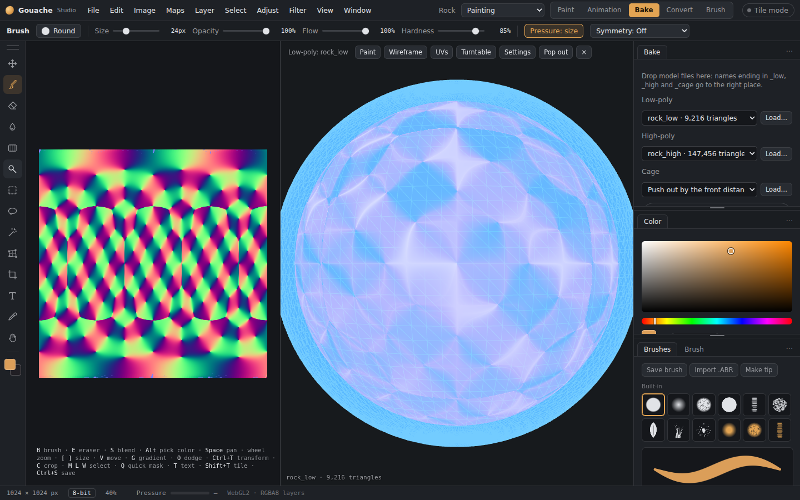
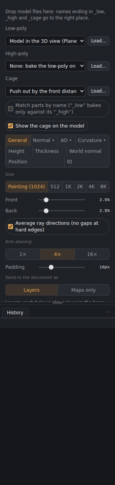
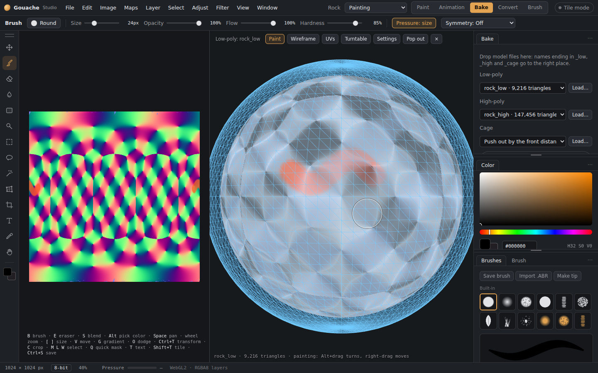

# Baker

The **Bake** tab (top right, or **Maps › Bake from high poly…**) copies the detail of a high-poly model onto the low-poly model's UVs, at the document's size. For a bigger bake, change *Image › Image size* first.

*The Bake tab: settings on the right, the bake on the model in the middle, the baked map on the left.*

## UVs: checking and auto unwrap
Every model you load as a low-poly (in the New 3D Paint Project window, the Bake tab, or dropped on the 3D view) has its UVs checked.
- **No UVs:** a window says so and offers **Auto unwrap** or **Continue without UVs** (you can look at the model, but not paint or bake it).
- **Bad UVs:** if islands overlap, parts lie outside the 0–1 square or the texel size is very uneven, a window lists the problems and offers **Optimize layout** (pack the islands you have again so they stop overlapping), **Auto unwrap instead**, or **Keep as they are**. In the New 3D Paint Project window the same choice is a drop-down under the mesh.

**Auto unwrap** cuts the model into pieces where the surface turns, flattens each piece, gives all pieces the same texel size, and packs them into the 0–1 square with a gap that grows with the texture size (about 8 px at 1K, 16 px at 2K, 32 px at 4K) so mipmaps do not bleed. It works best on hard-surface props and weapons; very organic shapes are stretched a little more.

**Review it in the Bake tab.** The **UVs** card (above the models) shows the layout flat, with overlaps in red, and puts a numbered checker on the model so you can spot stretching:
- **Style** and **Seam angle:** Hard surface cuts at every noticeable edge, Organic cuts less.
- **Padding:** the gap between pieces, in pixels. **Layout:** one square per material (each becomes its own texture set in 3D Paint) or one shared square.
- **Style:** Hard surface, Balanced, Organic or **Artist style**. Artist style makes fewer, bigger pieces (about 3 times fewer than Balanced), joins small neighbours while they can lie flat so the seams stay on hard edges, stands pieces upright, shrinks a very long piece a little and splits a piece that would stretch too much with a straight cut. It was tuned on 20 hand-made unwraps; it is slower than the other styles on big models (a few seconds, with the progress bar).
- **Seed and Re-roll:** every seed starts the pieces in another order and packs in another order, so Re-roll gives a different, valid layout; type a seed to come back to one you liked.
- **Best of 24:** tries 24 ways of packing the same pieces and keeps the tightest.
- **Optimize layout** packs a model's own islands again; **Original UVs** goes back to the file's UVs.
- **Export model with UVs…** (also in the File menu): OBJ, glTF binary (.glb) or binary FBX, with the UVs, normals and one material group per material, at the file's own size or as shown in the app.

**The fun part (0.55):**
- **On the model:** Off, **Checker**, **Stretch** (green = a perfect fit, yellow to red = stretched) or **Texel size** (blue = small, green = right, red = big). The same colours are drawn in the flat picture, and the seams are white lines on the model.
- **Seam angle** re-cuts live while you drag it (for very big models the update waits until you let go).
- **Clothing (pattern) style:** finds the closed loops of a garment (where a sleeve meets the body, cuffs, hems), cuts along them, and puts one seam down the length of each tube along hard edges, so a sleeve unrolls into a flat panel like a sewing pattern. A piece that still stretches too much gets one more cut at its most stretched spot.
  - A piece that lies on itself after flattening (the body of a jacket, with its shoulders) is laid flat triangle by triangle instead, and any overlap that is left is cut away: side seams under the arms (front and back panels), thin plates cut front from back, and a small patch cut loose along the shortest seam where two layers still lie on each other. The cuts are kept only when the pieces come out flatter.
  - Pieces are packed by their real outline, so small pieces fill the corners of big ones.
  - Check overlaps also finds a piece that covers itself.
- **Relax:** evens out the stretching inside each piece without moving the seams. *Strength* sets how long it works; *Keep outlines* leaves each piece's border where it is (only the inside moves); with it off the piece can change shape and the pieces are packed again if they now overlap.
- **Check overlaps / Fix overlaps:** counts the faces that share space with another piece or fold over inside their own piece, and shows them in red on the layout and on the model (On the model › Overlaps). Fix relaxes folded pieces and packs the pieces apart.
- **Bigger preview:** hover the small UV picture and a large one (up to 640 px) appears beside it.
- **Progress and Stop:** unwrapping, Re-roll and Roll the dice show a progress bar with a **Stop** button, and the app stays responsive while they work.
- **Roll the dice:** 12 layouts at once, each with how much of the square it uses and how many pieces it has. The tightest is marked *best*. Click a tile to use it; the ★ pins a layout so it stays when you roll again. Rolling needs a model that was auto unwrapped.
- **Unfold:** the slider (or **Play**) slides the model open into the flat layout; a model with several materials shows each material's square side by side. The cage and high-poly are hidden while unfolded.

When the UVs change, baked maps from before are cleared (they no longer fit); bake again. Paint you already made in 3D Paint does not follow new UVs.

## The Bake tab
- The **3D view** shows the low-poly large in the middle. While a bake runs you watch it fill in on the model, piece by piece, and you can turn the model as it goes. **Cancel** stops it at any point.
- The **canvas** on the left shows the baked map.
- **Show** chooses what you look at:
  - **Material (lit)** is a clay model with the baked normal and AO. You can tick *Use the document's base colour on the model*.
  - Any single baked map on its own.
  - The skew or offset map.
  - **C** steps through them on the model (**Shift+C** backwards).
- **Show high-poly** (when one is loaded): **See-through** draws it over the low-poly to check they line up, **Only** shows it on its own in grey clay.
- The Bake tab has **its own canvas**, sized by **Size** in the General tab (the painting's size unless you choose another). Baking never touches your painting until you send the results, and the tab shows only its own panels.
- Bakes stay in the tab, so you can check them and bake again as often as you like. Tick the maps you want under **Send to the painting, or export**, then **Send to Paint** adds them as layers, or **Export…** saves them as PNG files (you choose a folder on the desktop; the browser gives a zip).
  - Tick **Send results to layers automatically** to have every bake go straight into the document.
  - **Replace the last baked layers** swaps the previous bake's layers for the new ones, instead of piling them up.

## The top bar
The **Bake** button is big and bold at the top of the panel and stays in view while you scroll. **Send to Paint**, **Send to 3D Paint** and **Export…** sit right under it (they switch on once there is a bake and something is ticked). The ticks for which maps to send are further down under *Maps to send or export*.

The Bake panel is one wide panel in two columns, so everything is in view without scrolling on a normal screen: models, maps to bake, sending and the Show list on the left, and the settings of each map on the right. **History** is only a tab beside it. If you make the panel narrower, the columns stack.

## Bevel preview and baking

Under **Normal › Bevel shader**, enable the bevel and **Preview before baking**. The material view shows rounded edge shading on the high-poly when supplied, otherwise the low-poly. The preview refines in small pieces; its status says when it is ready. Geometry and the silhouette stay unchanged.

- **Width units:** use a percentage of the model, or millimeters. For millimeters, set **Model file units** to the units used to export the model; importers normalize the viewport size, so the original file scale matters. Changing the width-unit choice preserves the current radius.
- **Minimum edge angle:** apply the effect where the surface turns more sharply than this angle.
- **Samples:** more probes give a better estimate of the rounded normal and take longer. The default is now 48; increase it for the final bake when you need extra smoothness.
- **Bevel hard edges:** respect the hard edges authored in the model's corner normals, even when the angle limit would exclude them.
- **Same surface only:** enabled, other imported objects are ignored. Disabled, intersections can receive rounded shading without merging or making a boolean union. Separately loaded high meshes keep their identities even when their names match.
- **Vertex color width mask:** choose a channel of the imported vertex colors. Zero removes the bevel, half halves the radius, and one keeps the full width. Models without vertex colors keep the full width.

**Bake bevel normal** creates a tangent-space normal map, including when there is no high-poly. The world-normal bake uses the same rounded normals. Preview turns off after the normal bake so the resulting normal map supplies the shading. Re-enabling preview recalculates the bevel rather than applying it twice to the previous bevel bake. Existing normal detail is retained by the surface probes.

Use widths that fit the part: a shading bevel cannot change a large silhouette or replace modeled forms. Connected edges blend by their distance and imported smooth normals; separate-object intersections use scene probes. The result depends on the source geometry and its imported normals. Width is shared by the bake, with per-material shares and vertex colors for local variation. **Use preview material**, **Preview metalness** and **Preview roughness** let you inspect highlights without changing your material or baked maps.

## Settings: one tab per map
Under the model rows, the tabs hold the settings. A dot marks the maps that will be baked; tick **Bake …** at the top of a tab to turn a map on or off.
- **General:** Front, Back, Average ray directions, Anti-aliasing, Padding, and how bakes are sent to the document (below).
- **Normal:** OpenGL style (green up). For DirectX engines, flip green when exporting (*File › Export textures*).
- **AO:** Rays, Reach and **Spread** (narrower keeps the shading to deep cavities).
- **Curvature:** see below.
- **Height**, **Thickness** (its own Rays and Reach), **World normal**, **Position** and **ID** (where its colours come from). Every bake has its own tab; a dot marks the ones that will be baked.

*The map tabs, here AO.*

## Curvature
Light on edges and corners, dark in creases, mid-grey on flat areas. **From** picks where it comes from:
- **The shape** (the default): measured on the high-poly itself, so it comes out right on mirrored and flipped UVs. Without a high-poly it's measured on the low-poly's corners.
- **Baked normal:** worked out from the normal map baked with it.
- **Normal map:** worked out from the document's own normal map, with no high-poly needed.

For the last two, **Flip green** swaps the edges and creases that run across the texture, in case a normal map's green points the other way.
- **Radius:** how far around each point it looks. Small gives thin, sharp edges; large gives broad, soft ones.
- **Strength**, and **Edges** and **Creases** to set the light and dark sides separately.
- **Also make edges-only and creases-only maps:** two extra layers, white where the edges (or creases) are, handy as masks.

## Sending bakes to the document
**Send to 3D Paint** sends the low-poly and the ticked maps to 3D Paint: each material's maps go to its own texture set (see [3D Paint](3D-Paint.md#mesh-maps-from-the-bake-tab)). With several materials, tick **Bake each material separately** before baking; a **Material** menu then shows each one's result.

**Send as** (General tab):
- **Layers** (the default): every bake is also a layer in the **base colour**, so bakes blend with each other there. For example, set the curvature layer to *Overlay* over the AO. AO, curvature and height also go into their own maps. The edges-only and creases-only layers sit, hidden, in the curvature group.
- **Maps only:** each bake only in its own map, as before.

Each map arrives as a **plain layer** (no folders), so you can set blend modes between them. Layers that would cover your colours (thickness, world-space normal, position, ID) start hidden. Bakes of a different size are scaled to the painting.

## Models

- **Loading models:** press **Load…** next to Low-poly, High-poly or Cage, or **drag model files** onto those rows. You can also drop them anywhere in the Bake tab: files named `…_low`, `…_high` and `…_cage` go to the right place by themselves. A loading bar shows big files coming in. FBX must be binary FBX (not text).
- **Low-poly:** the model in the 3D view, or a file (OBJ, glTF, GLB, FBX). It must have UVs.
- **High-poly:** load a file. Or choose **None** to bake the low-poly on its own (see below).
- **Cage:** either *Push out by the front distance*, or load a **cage model**, which is your low-poly pushed outwards with the same vertices and triangles.

## ID colours
In the **ID** tab, *ID colours from* chooses where the ID map's colours come from:
- **Separate meshes:** one stable, distinct colour per disconnected piece, including several pieces joined into one imported object. Shared UV or normal seams do not split a piece; objects with identical names stay distinct.
- **Materials:** one colour per material.
- **UV islands:** one colour per connected UV island.
- **Vertex colours:** the colours painted on the high-poly's vertices (OBJ, glTF, FBX).
- **Polypaint:** ZBrush polypaint. Export the OBJ from ZBrush with Polypaint on.
- **Auto:** vertex colours, then materials, then separate meshes.

The tab lists what the loaded model has.

## Rays
**Show the cage on the model** draws where the rays start as a see-through blue shell around the model. It follows Front, the offset map and a loaded cage model, so you can check the cage covers the high-poly.

Each pixel of the low-poly's UVs sends a ray from just outside the surface back through it and records where it first meets the high-poly.
- **Front:** how far outside the surface the ray starts, as a % of the model's size.
- **Back:** how far inside it still looks.
- **Average ray directions:** stops gaps and seams at hard edges.
- **Match parts by name:** `crate_low` bakes only against `crate_high`. This stops close parts from leaking into each other. The endings `_low/_high`, `_lo/_hi` and `_lp/_hp` are recognised, and the panel lists the parts it matched.

If parts of the high-poly are missed, raise the distances. If detail from other parts leaks in, lower them or match parts by name. To fix just one area, paint an offset map (below).

## Maps
| Map | Where it goes (as layers) | Maps only |
|---|---|---|
| Normal (OpenGL) | Normal map | Normal map |
| Height (high-poly above = light) | Height map and base colour | Height map |
| Ambient occlusion | AO map and base colour | AO map |
| Curvature (+ edges and creases) | Curvature map and base colour | Curvature map (edges and creases: base colour, hidden) |
| Thickness (white = thick) | Base colour, hidden | Base colour, hidden |
| World-space normal | Base colour, hidden | Base colour, hidden |
| Position (gradient over the model's box) | Base colour, hidden | Base colour, hidden |
| ID colours (ID tab: **separate meshes**, **materials**, **vertex colours** or **ZBrush polypaint**; Auto uses vertex colours, else materials) | Base colour, hidden | Base colour, hidden |

Each baked map arrives in **its own group** (“Baked normal”, “Baked AO”…), so they're easy to find in the layer stack. Maps the document doesn't have yet are added for you. Groups for maps that live in the base colour (thickness, world-space normal, position, ID) start hidden so they don't cover your colours: show one, or use it as a mask with *Select › Load selection*.

## Low-poly on its own
Choose High-poly **None** to bake AO, **curvature from the model's own shape**, thickness, ID, world-space normal and position. Normal and height are skipped because they'd come out flat.

## Quality
- **Rays and reach** (AO and Thickness tabs): how many rays each pixel sends. More rays are smoother but slower. Reach is how far those rays look.
- **Anti-aliasing:** 1×, 4× or 16× samples per pixel. 16× is the default. For very large maps it steps down by itself so the oversized image still fits the graphics card. A pixel's AO and thickness rays are shared out over its samples, so anti-aliasing smooths the edges without multiplying the time AO and thickness take.
- **Padding:** extends colour past the UV edges so seams don't show.

Baking runs on the graphics card in small pieces with a progress bar and **Cancel**, so the app stays responsive.

## Clean normal maps
A baked normal map is renormalised after the samples are averaged, flat surfaces come out exactly flat (128, 128, 255), the high-poly's normals keep full precision (up to three million triangles) and rays no longer slip between touching triangles. This keeps flat panels free of speckle.

## Compare with another normal map
After a bake, **Compare with a normal map…** (under *Show*) asks for a normal map made elsewhere, for example in Marmoset Toolbag. It tries both green directions, tells you the average angle between the two maps and how much of the picture is within 1°, 2° and 5°, and adds a grey difference picture to the painting (white = 10° or more).

## Big high-polys
Before the first bake the high-poly is sorted into a **search tree** (*Sorting triangles…*), so each ray only tests the few triangles near it. This runs in the background, and the tree is kept for later bakes of the same models. The desktop app also saves it in the **disk cache** (see [Preferences and performance](Preferences-and-performance.md)), so baking the same high-poly after a restart skips this step. High-polys of about 20 million triangles work on a card like an RTX 4080; the app says so if one is too big for the card.

## Fixing the bake: skew and offset
Sometimes a bake comes out wrong in places. Floating details like screws, bolts and panel lines come out smeared or leaning, parts of the high-poly are missed, or detail from a nearby part leaks in. You fix those by painting two maps on the low-poly, the same idea as Marmoset Toolbag's projection tools.

Under **Fix the bake**, pick **Skew** or **Offset**, then paint with the Brush (the Eraser puts the neutral colour back):
- **Skew** (neutral is white): paint **black** over details that lean or smear. The rays there shoot straight out of the surface instead of along the averaged direction. White keeps the averaged direction, which avoids gaps at hard edges.
- **Offset** (neutral is grey): **lighter** reaches further, for parts of the high-poly that were missed. **Darker** reaches less far, for detail leaking in from nearby. **Estimate offset** makes a starting offset map for you by measuring how far the high-poly actually is at each pixel.

You can paint **on the model in the 3D view** or on the map on the canvas. The areas you paint show as a tint: orange for skew, orange or blue for offset.

After each stroke, the quick maps (normal, height, curvature, position, world-space normal, ID) **re-bake straight away where you painted**, so you see the fix at once. AO and thickness are slower, so they update on the next full **Bake**.

Every stroke can be undone. **Clear skew** and **Clear offset** start over. Both maps are saved in your .gouache file.

*Painting skew over part of a model. The orange tint shows where the rays now shoot straight out.*

## Exporting for DirectX engines
Bakes are stored as OpenGL normals, like everything else in the app. Pick the engine preset in *File › Export textures for a game engine* and DirectX normals (Unreal) are flipped on export.

## Multiple high-poly files

You can rotate the viewport while a bake runs. Bake pauses restore the shared renderer’s clipping and drawing state before handing control back to the view, preventing black flashes and clipped frames.

Use **Add…** beside High-poly to add another file. Each file keeps its original position in the model. Remove individual files with × in the list. **Load…** replaces the high-poly set; dropping another `_high` file adds it.

Use **Material** in the viewport toolbar (or **Escape**) to turn off UV and bake-map inspection. Clicking an active UV inspection mode again also turns it off.

## Lighting (light rig)

The **Lighting** bake writes the light of a rig onto the model, with the soft shadows the model casts on itself, like a Marmoset light setup baked into a texture. Tick **Lighting** in the list of maps and open the **Lighting** settings tab.

- **Auto rig (key, fill, rim, sky):** three-point lighting around the model (it faces the front, +Z): a warm key light from the front left above, a cool weaker fill from the right, a bright rim from behind, and a little sky.
- **+ Sun, + Point, + Spot, + Sky** add a light. Sky uses the environment picture (HDRI) of the 3D view, turned as there; with none it is a plain white sky.
- **The list:** every light with an eye to turn it on or off. Click a light to open its settings:
  - name, type, colour, strength, shadows on/off, shadow rays (more is smoother, slower),
  - Sun: shadow softness, height and turn,
  - Point and Spot: shadow softness (light size) and reach; a Spot also has its cone and soft edge, and always points at the middle of the model.
- **In the 3D view:** the lights are drawn on the view. Drag a sun to turn it around the model. Drag a point light or spot to move it across the screen; hold Shift to move it nearer or further.
- **Exposure** brightens or darkens the whole bake. **Materials to bake** (eyes) leave parts out; left-out parts still cast shadows.

Where it goes:

- **Send to 3D Paint:** the bake becomes the texture set's **Lighting** mesh map, and also a **Baked lighting** layer in Multiply mode over the colour, which you can paint on.
- The **Hand-painted** layer and the **Stylize** layers light the model with the Lighting mesh map when there is one (their **Light from** setting: the baked Lighting map, or their own direction).
- **Send to Paint** adds it as a Multiply layer; **Export** writes Lighting.png.
- The 3D Paint **Bake mesh maps** window can bake Lighting too, with the same rig.
