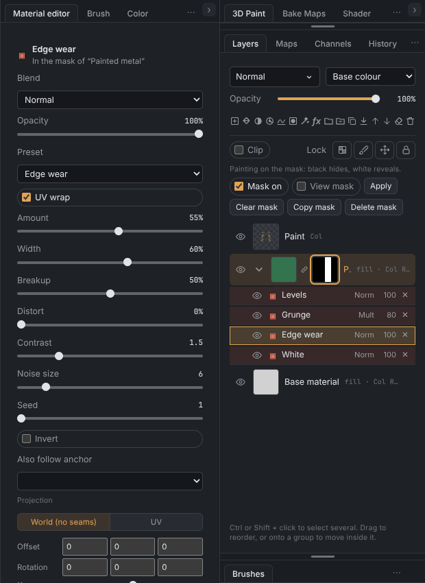
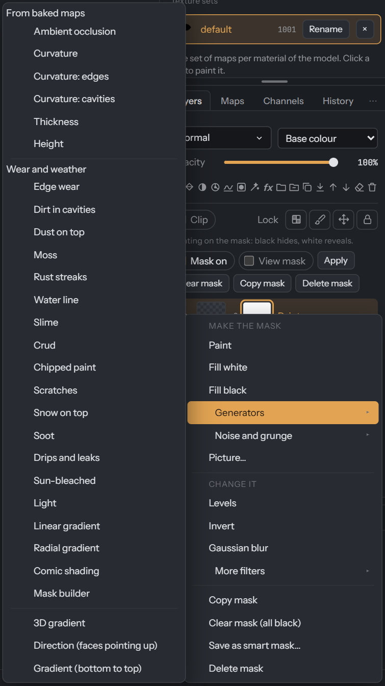
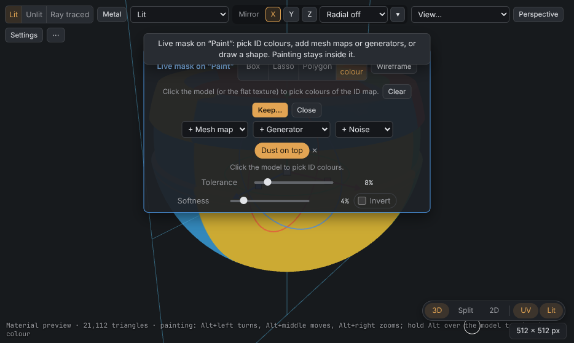
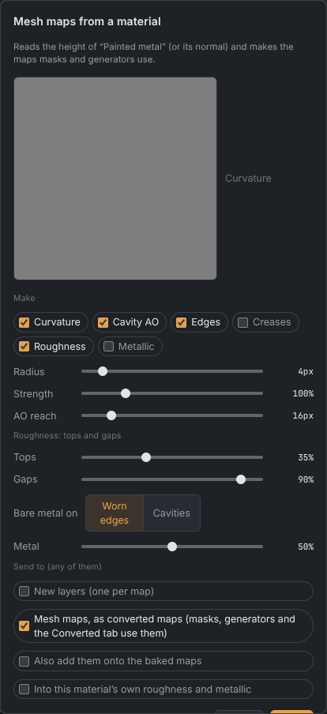

# Masks and effects

A layer's mask can hold **rows of its own**, like Substance Painter's mask effects: paint, fills, baked maps, ID colours, noise, generators and filters, stacked and blended. They sit **under the layer** in the Layers panel. Everything stays live: change a row at any time and the mask follows. The same works in 3D Paint and in the Paint tab.

*“Painted metal” shows through a mask made of a white fill, Edge wear, a grunge noise on Multiply and Levels. Edge wear is selected, so its settings are in Properties.*

## Adding rows
Select the layer, click its **mask thumbnail**, then press **✦** (the effects button under the layers) and pick a row. A layer without a mask gets one.

**Every filter** can go on a mask: the ✦ menu has the usual ones under **Filter**, and **All filters** lists the rest in the Filter Gallery's folders. A filter row changes everything below it in the mask. You can also **right-click a layer › Filter this layer ▸** or **Filter its mask ▸**.

Right-click a **mask thumbnail** and open **Generators** to choose a baked map, an edge wear or dirt effect, or a gradient.

**Generators** have a **Distort** setting: the edges and cavities they find are read a little to the side, following a noise, so wear and dirt break up irregularly instead of following every edge exactly.

**Your own grunge in a generator:** select a generator row and, in Properties under **Grunge**, click **Choose from Textures…** (photo grunges, mixed, generated or your own) or drop a picture onto the box. The picture then breaks up the mask instead of the built-in noise; **Breakup** sets how strongly. **Grunge tiling**, **Grunge rotation**, **Grunge contrast**, **Grunge level** and **Invert grunge** adjust it (you can also drag a tile from the Textures panel onto the box), and **Use built-in noise** goes back. With the World projection the picture is laid over the model from three sides, so it has no seams.

Click the layer's own thumbnail instead, and ✦ adds **effects to the layer's content** (blue **fx** rows): filters such as Blur, Levels or Hue/Saturation that change the layer's own maps before it is blended.

## The rows
Rows are listed under the layer, **top first**. Each has an **eye**, its **blend mode** and **opacity**, and **✕** to delete it.
- **Click** a row to change it in **Properties** (the tab beside Colour).
- **Drag** a row up or down to reorder it.
- **▾** on the layer folds its rows away.
- Red **▣** rows are in the mask; blue **fx** rows are on the content.

Blend modes: Normal, Multiply, Add, Subtract, Screen, Min, Max and Overlay. A row covers what is below it where it is white or grey. **Filters change everything below them** in the mask.

## What a mask can hold
| Row | What it does |
|---|---|
| **Paint** | Paint on the model or the canvas: white shows the layer, black hides it. The eraser takes paint away again. A new Paint row changes nothing until you paint on it. |
| **Fill white / black** | The whole mask, flat. |
| **Mesh map** | A baked map of the texture set (AO, curvature, thickness, height…), or a converted one (see below). |
| **ID colour** | Pick colours of the baked ID map (Tolerance, Softness, Invert). |
| **Direction** | Faces pointing up (dust, snow), down, or along an axis, with an angle and softness. |
| **Gradient** | From bottom to top, or side to side, over the model. |
| **Noise** | Clouds, Cells, Grunge, Scratches, Streaks, Dots or Fibres: *World* (in 3D on the model, no seams) or *UV*. |
| **Picture** | Your own image: UV, Triplanar, Planar or Spherical. |
| **Another layer's mask** | Follows that mask, live. |
| **Generator** | The presets: Edge wear, Dirt in cavities, Dust on top, Moss, Rust streaks, Water line, Slime, Crud, Chipped paint, Scratches, Snow on top, Soot, Drips and leaks, Sun-bleached. Each has Amount, Width, Breakup, Contrast, noise size and seed. |
| **Filters** | Levels, Curves, Threshold, Posterize, Invert, Blur, Box blur, Motion blur, Sharpen, High pass, Edges, plus **Grow / shrink**, **Warp** (breaks up clean edges) and **Slope blur** (smears along a noise). |

Pictures, noise and generators can be **moved, turned and scaled**: select the row and use the gizmo on the model (World, Triplanar, Planar, Spherical) or the frame on the canvas (UV), or the fields in Properties.

Generators read the texture set's baked curvature and AO. Without a bake they use curvature worked out from the model, which is rougher, so bake for the best results. On the flat Paint canvas, "up" is the top of the texture.

**Flatten mask** (right-click the layer) keeps the result as a plain mask and drops the rows.

## Mask mode
**Alt + click** the mask thumbnail to see the mask on the model in black and white. The bar has **Paint** (nothing paints until it is on), **Box**, **Lasso**, **Polygon** and **ID colour**; see [3D Paint](3D-Paint.md#mask-mode). Painting goes into the selected Paint row, or the top one, or a new one.

## Live mask (a layer without a mask)
**Right-click a layer › Live mask…** (or ✦ › Live mask) gives a layer without a mask the same tools, as a **live selection**: pick ID colours, add a mesh map, a generator or a noise, or draw a shape with Box, Lasso or Polygon on the model. Painting and fills stay inside it.

**Keep…** asks what to do with it:
- **As a mask stack:** the layer gets a mask made of those rows, still live.
- **Apply to the layer:** the layer is cut to it (what is outside is erased), and no mask is added.

**Close** stops it without keeping anything.

## Light, gradient and comic generators

Select a mask, then choose **✦ › Generator**. **Light** reveals faces pointing towards a chosen direction: adjust Horizontal angle, Elevation, Wrap and Cavity shading. Cavity shading reads baked AO; this is a directional mask rather than a cast-shadow simulation.

**Linear gradient** follows a model's normalized position in one of six directions. **Radial gradient** fades away from an adjustable centre. Both have Start and End controls, Linear, Smooth or Stepped falloff, Offset, Contrast and Invert. Swapping Start and End reverses the fade; equal endpoints make a sharp cutoff. Without a model, these generators use the flat texture.

**Comic shading** offers shading bands with dots, solid ink shadows or halftone dots. Choose the light direction and adjust Bands, Dot density, Dot size and Dot angle. Dots project along the dominant surface direction. All four generators stay live and work in exported smart masks and materials.

### 3D gradient
**✦ › 3D gradient** (or right-click a mask › Generators › 3D gradient) adds coloured points around the model. Every spot of the model blends the points' values by how near it is to each, so you can shade a mask from one part of the model to another in any direction. The points show as dots in the 3D view and on the flat canvas (each where the model's surface is nearest to it; dragging it there slides it over the surface): drag a dot to move it across the view, drag its red, green or blue arrow to move it along X, Y or Z, and press **Delete** to remove the selected point. In Properties, **+ Add point** then a click on the model drops a new point just above the surface; each point has its own value and **Reach**, and **Softness** sets how smoothly they meet (low = sharp regions, high = smooth blends). The same gradient is also a layer: **Layer › New › 3D gradient layer** (see Layers), and any material channel can use **3D gradient** as its source.

## Mesh maps from a material
**Filter › Mesh maps from material…** (or right-click a material layer) reads the material's **height**, or its normal, and makes **Curvature**, **Cavity AO**, **Edges**, **Creases**, **Roughness** (smooth on the tops, rough in the gaps) and **Metallic** (bare metal on worn edges or in cavities).

Tick where they go (any of them):
- **Mesh maps**, as *converted* maps: mask rows, generators and the **Converted** tab of the Properties panel use them.
- **Added onto the baked maps**, so the baked curvature and AO also show the material's bumps.
- **New layers.**
- **Into the material's own roughness and metallic**, linked to the converted maps.

In Properties, each channel of a material can be a colour or value, an **Image**, a **Mesh map** (baked) or a **Converted** map.

## UV wrap

Generators and filters have **UV wrap** on by default. When an effect samples beyond a texture edge, it reads the opposite edge, including intermediate blur passes and anchor-height curvature used by generators. Turn it off in Properties or the filter settings to clamp at the border. The choice is saved with the effect and exported smart materials.

This repeats across the texture's outer edges. It does not join separate UV islands on a mesh, and it does not change the document's tile-painting mode.

**Across UV seams on a model:** in 3D Paint, Warp rows, the Warp filter and the Gaussian and Box blurs work on the model's surface, so both sides of a seam match. A generator's **Distort** roughens the edges and cavities on the surface too, and **Slope blur** smears along the surface.

## Wear generators

For worn metal, select a mask and add **Metal Edge Wear**. **Edge growth** spreads the band beyond exposed edges, and **Edge distortion** makes it irregular. Add **Use Wear** for directional scuffs on exposed areas. Choose a concrete or steel scan in the generator, or use **Choose from Textures** to add your own grunge to the breakup.

### Rust & Runoff and Mineral Buildup

In **Paint** or **3D Paint**, add a mask to a fill layer and choose one of these from **Generators**. **Starts from** picks baked edges and cavities, the mask rows below, or a painted anchor. To place an effect by hand, add a black mask and paint white spots in a Paint row below the generator.

- **Rust & Runoff** starts with Spot Rust, Rust Under Paint, or Rain Streaks. Set gravity, length, width, taper, and branching. Use the same source and seed on separate fills for rust coverage, fresh oxide, corrosion pits, and flat runoff stains. Use a Height value below mid-gray for pits. **World** projection with **UV wrap** follows connected UV islands within a texture set on standard UV meshes. Tiled layouts use UV-space flow.
- **Mineral Buildup** makes rings at a chosen waterline, crust at a leak, or chalky buildup from the mesh maps. Adjust band count and waterline height, or use **Leaking Pipe** with a painted source and gravity. The Crust, Rough deposits, and Runoff stains outputs can go on separate fills.

Drag a texture into the **Grunge** box to use it for breakup. These rows stay editable when you save a project or smart mask.

## Mesh-map Mask builder

Choose **Mask builder** from Generators (including the 3D Paint mask right-click menu). It adds one live generator row with separate strengths for curvature edges, curvature cavities, AO cavities, facing direction, position gradient, height and thin areas. The inputs add together, followed by Offset, Contrast, Grunge breakup and Invert.

The builder reads the texture set's baked mesh maps. World normal and position take priority for direction and position; the model supplies them when those bakes are absent. Height can also use the document's height channel. Thickness needs a thickness bake. Curvature can follow a height anchor. Position start/end controls define the gradient; reverse them to reverse the fade. Direction softness widens the facing-angle range.

Use a library grunge picture row above the builder in Multiply for a specific scratch or dirt pattern. Keep a paint row above it for touch-ups. All strengths and settings stay editable and save with projects and smart masks.

Mask Levels reads the input mask below its row, including for its histogram and Auto. The simple handles and slider layout both update the actual mask. In the Sliders layout, typed black/white values use 0–255; midtones uses gamma.

In **3D Paint**, Box Blur and Gaussian Blur with **Mesh seams** enabled also extend the filtered result eight pixels outside the active mesh’s UV islands. This prevents the 3D preview from mixing empty border pixels into painted edges. It applies to effects attached to a layer as well as filter layers; the original paint is retained. Very distant views can still blend wider areas of the atlas, and separate texture sets are not connected by this option.

The 3D Paint preview applies the same eight-pixel UV border to ordinary paint and material maps, even without a blur effect. Small painting updates refresh the affected border and smaller previews together; this does not alter the original layer.
