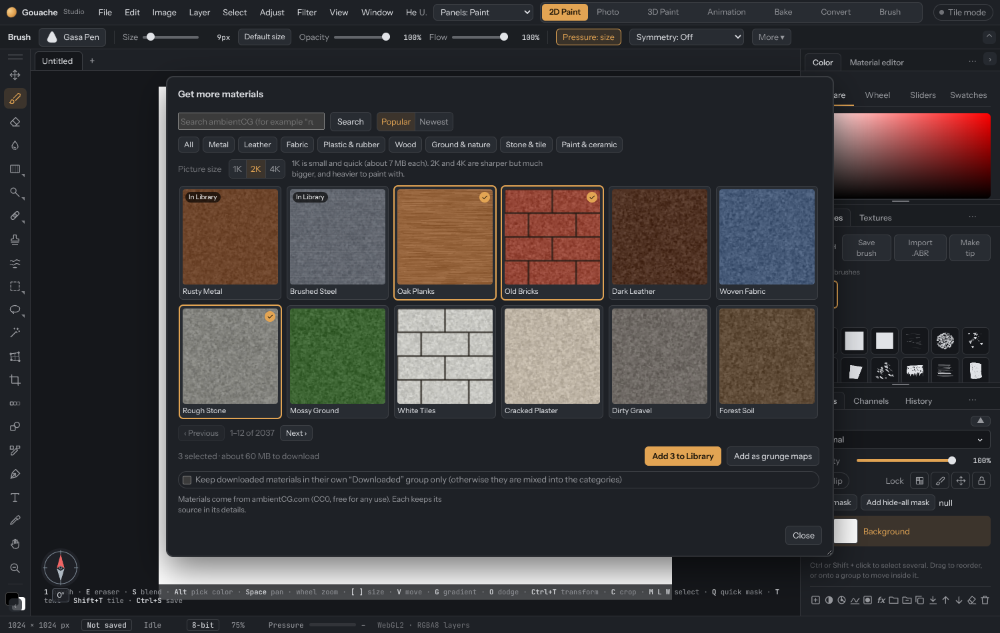

# Get more materials (online library)

**Materials › Library › Get more…** opens a window inside the app where you can browse [ambientCG](https://ambientcg.com) or [Poly Haven](https://polyhaven.com) (use the **Source** switch at the top) and add materials to your Library. It needs the **desktop app** and an internet connection. Everything you add keeps working offline afterwards.

## Adding materials

1. Search, or pick a category (Metal, Leather, Fabric, Plastic & rubber, Wood, Ground & nature, Stone & tile, Paint & ceramic). Sort by **Popular** or **Newest**.
2. Choose the **picture size**: **1K** (small and quick, about 7 MB each to download), **2K** or **4K** (sharper, much bigger, and heavier to paint with).
3. Click materials to tick them. The window shows how much will be downloaded. Materials you already have are marked **In Library**.
4. Press **Add to Library**. Each material is downloaded, built into a normal material (colour, roughness, metallic, normal, height) and saved on this computer. **Cancel** stops the current download.

**Add as grunge map** takes the grey height map (else AO, else roughness) of each ticked material and adds it to **Textures**.

## Two sources

- **ambientCG** has about 2,000 materials, plus a **Grunge maps** category (scratches, smears, dirt, rust) for the Textures panel.
- **Poly Haven** has about 870 textures. Each material is fetched as its map files (colour, normal, packed roughness/AO/metal, height). Each keeps its creator's name and a link to its page. The window shows *Powered by Poly Haven* while it is selected.

Both are CC0: free for any use, no credit required.

## Where they appear

Downloaded materials are **mixed into the Library categories** by default, and also listed under a **Downloaded** chip. Tick *Keep downloaded materials in their own "Downloaded" group only* to keep them out of the categories. Click the **×** on a downloaded tile to delete it (you can download it again).

Each material keeps its credit (for example *ambientCG.com Metal047B (CC0)*). Materials from ambientCG are CC0: free for any use, no credit required.

## Bigger pictures for the whole Library

**File › Add-ons… › Library** can upgrade every material that comes with the app from 1K to **2K or 4K**. It tells you the download and disk size first, runs one material at a time, and you can **Stop** at any time; what is done is kept and pressing Upgrade again carries on. **Back to 1K** removes the upgrades. Upgraded materials keep their names and categories and replace their 1K originals in the Library.

Large pictures use a lot of memory when painting. Most projects do best with 1K or 2K.

## Good to know

- The desktop app only talks to ambientCG's own servers.
- A 2K or 4K material's pictures are let go from memory once it has been added to a layer.
- The web version cannot download (the browser blocks it). Download from ambientcg.com yourself and use **Materials › From textures…**.

## Transparent materials

A material whose picture has see-through parts (or an Opacity map) shows **Cut out by the material's transparency** in the Material panel. Tick it to add a mask made from that transparency, so the layers under show through in every map, not only the colour. Untick it to remove it again.
