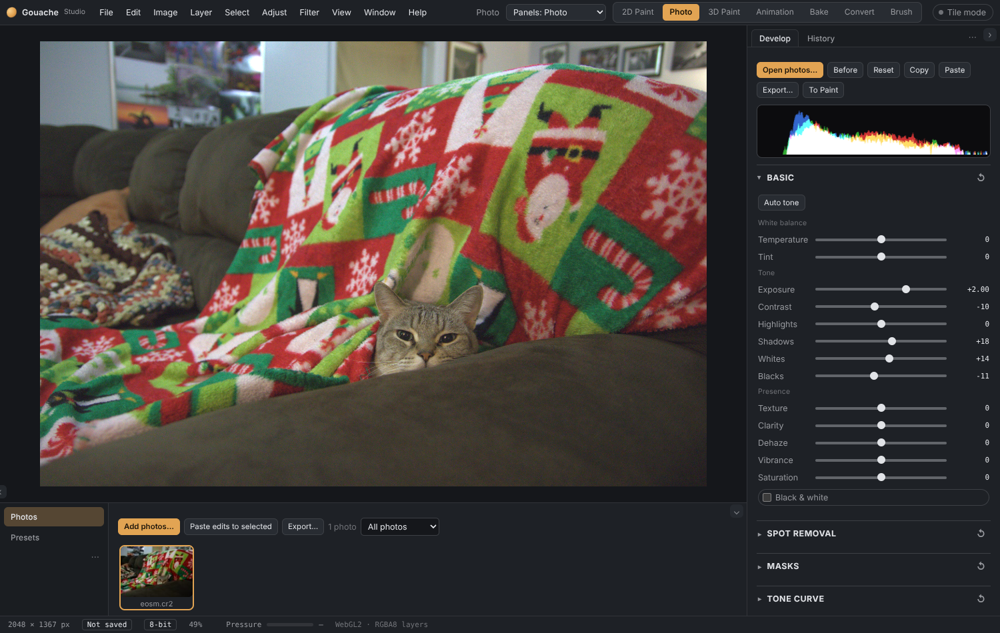
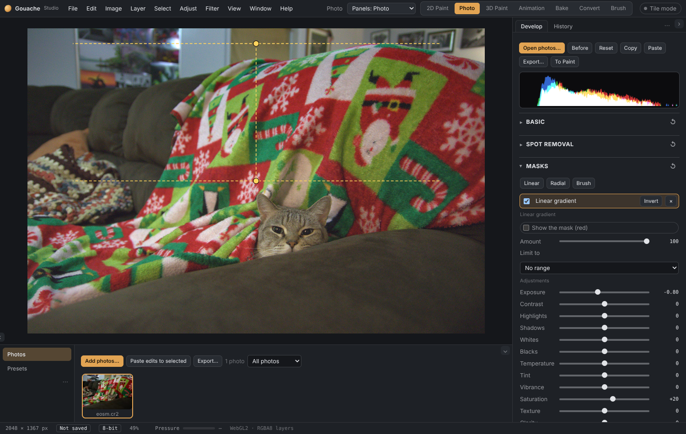

# Photo tab

The Photo tab (next to 2D Paint) is a Lightroom-style photo editor. Open photos, change light and colour with sliders, fix the crop and tilt, edit just one part of the picture, and export. It has its own layout: the Develop panel on the right, a strip of your photos along the bottom, and your photo in the middle.

Your original file is never changed. The edits are small settings saved beside it (a `.gphoto` file in the desktop app, so they follow the photo; in the browser they are kept in the browser). You can always change or take them off.

## Opening photos
- **File › Open photos…**, the **Open photos…** button, **Ctrl+O**, or drop photos on the picture.
- JPEG, PNG, WebP, TIFF and **RAW** photos (Canon, Nikon, Sony, Fujifilm, Panasonic, Olympus, Pentax, DNG and many more). RAW files are developed with the camera's own white balance and sRGB colour, with full 16-bit headroom, so highlights and shadows can be pulled back.
- Click a photo in the strip to edit it. **Ctrl** or **Shift** click selects several; the arrow keys move to the next or previous one.
- Rate with **1–5** (0 removes the stars), **P** picks, **X** rejects. The drop-down in the strip shows only some photos (by stars, picks, rejects, or edited ones).

## Develop panel
- **Basic**: Auto tone, White balance (Temperature, Tint), Tone (Exposure, Contrast, Highlights, Shadows, Whites, Blacks), Presence (Texture, Clarity, Dehaze, Vibrance, Saturation), Black & white. Double-click a slider's name to reset it; the ↺ button on a section resets the whole section.
- **AI tools** (needs the [AI add-ons](AI-add-ons.md)): **Select subject…** and **Select sky** make masks.
- **Lens blur** (AI add-on: Depth): blur by distance from a focus you pick.
- **Relight** (AI add-on: Depth): add light to the picture. Tick *Add light*, then drag the light's dot on the picture. **Kind**: *Point light*, *Spotlight* (a cone you aim with its small square: Cone angle, Soft edge) or *Sun* (parallel light, no fall-off; Sun height low = long shadows; drag the dot and the square to turn the direction). Each light has Intensity, Reach, Height, Colour and Tint. **+ Add a light** gives up to four lights (Light 1–4; *Remove this light* takes one away). *The whole picture*: **Depth** (how bumpy the picture is treated), **Darken rest**, and **Dark colour / Dark tint** (a colour for the unlit side). *Shadows, shine and rim*: **Shadows** (things in the picture shade what is behind them), **Shine** with **Tightness** (a highlight), and **Rim light** (lights the edges that face the light). **Ready-made lighting…** sets everything at once: Golden hour, Window light, Studio (two lights), Spotlight, Moonlight, Sunset rim light, Neon, Candle and Overhead.
- **Upscale**: in *Export…* choose *Make it bigger (AI)* for 2×, 4× or 8× (AI add-on: Upscale).
- **Remove** (AI add-on): paint over something and it is filled from what is around it.
- **Spot removal**: press *Remove spots…*, click a blemish. The patch is copied from a clean place nearby (picked for you; drag the dashed circle to choose another) and either **Healed** (matched to the light around it) or **Cloned**. Size, Feather and Opacity can be changed.
- **Masks**: change one part of the picture only. See below.
- **Tone curve**: all channels or red, green, blue. Click to add points, drag them; right-click (or double-click) a point to remove it.
- **Colour mixer**: hue, saturation and brightness for eight colour bands.
- **Point colour**: press *Pick a colour…*, click a colour on the picture, then change just that colour (Hue shift, Saturation, Brightness, Range).
- **Colour grading**: tints for shadows, midtones and highlights, with Blend and Balance.
- **Detail**: Sharpening (Amount, Radius, Masking) and Noise reduction (Luminance, Colour; edges are kept).
- **Effects**: Vignette and Grain.
- **Geometry and crop**: Crop… (drag corners and edges; shapes like Original, 1:1, 4:5, 3:2, 16:9 or Free), **Auto level** (finds the horizon or walls), **Auto upright** (also makes leaning walls vertical) and **Full**, Straighten, Vertical and Horizontal keystone, **Lens distortion**, **Colour fringing**, Scale, flips, Fill the frame.

## Masks (local adjustments)
Add a mask with **Linear**, **Radial** or **Brush**, then use its sliders (Exposure, Contrast, Highlights, Shadows, Whites, Blacks, Temperature, Tint, Vibrance, Saturation, Texture, Clarity, Dehaze, Sharpness).
- **Linear**: strongest at the first line, fading out toward the second. Drag the dots; drag the line to move both.
- **Radial**: a round or oval area. Drag the centre dot to move it and the edge dots to resize; Feather and Rotation are sliders.
- **Brush**: paint where the change should happen (Paint / Erase, size, feather, flow). Four brush masks at most per photo.
- **Invert** swaps the affected and the untouched parts. **Amount** fades the mask. **Show the mask (red)** shows where it works.
- **Limit to** a **Luminance range** (only bright, only dark parts) or a **Colour range** (only one hue, and *Pick from the photo*) so a mask only touches what you want.
- Up to eight masks per photo. Masks stay on the picture's content, so they follow your crop and tilt.

## Presets, History, Snapshots
- **Presets** (the shelf tab beside Photos): ready-made looks with live thumbnails; save your own. A preset only changes what it contains.
- **History**: every edit is a step; click one to go back. **Ctrl+Z / Ctrl+Y** work too. **Snapshots** keep a named state you can return to.
- **Before**: hold the button or the **\\** key to see the photo as it was. **J** shows clipped highlights (red) and shadows (blue).

## Copy, paste and several photos
**Copy** (Ctrl+Shift+C) takes one photo's edits; **Paste** (Ctrl+Shift+V) puts them on this photo, or on every selected photo (*Paste edits to selected*). You choose which groups to paste (Basic, Tone curve, Masks and so on; the crop is left out by default).

## Export
**Export…** makes JPEG, PNG or WebP files at the original size, a chosen long side, or a percentage, with a quality setting. Several photos are put into a zip. **To Paint** puts the edited photo on a new layer in 2D Paint.

## Keys
| Key | What it does |
|---|---|
| Ctrl+O | Open photos |
| C | Crop |
| \\ (hold) | Before |
| J | Show clipping |
| 0–5 | Stars |
| P / X | Pick / reject |
| ← → | Previous / next photo |
| Ctrl+Shift+C / V | Copy / paste edits |

## Credits
RAW files are read with [LibRaw](https://www.libraw.org) through the `libraw-wasm` package (LGPL 2.1 / CDDL 1.0 and ISC). Not yet in this tab: panoramas, HDR merge, AVIF and JPEG XL export. The AI features are described in [AI add-ons](AI-add-ons.md).
