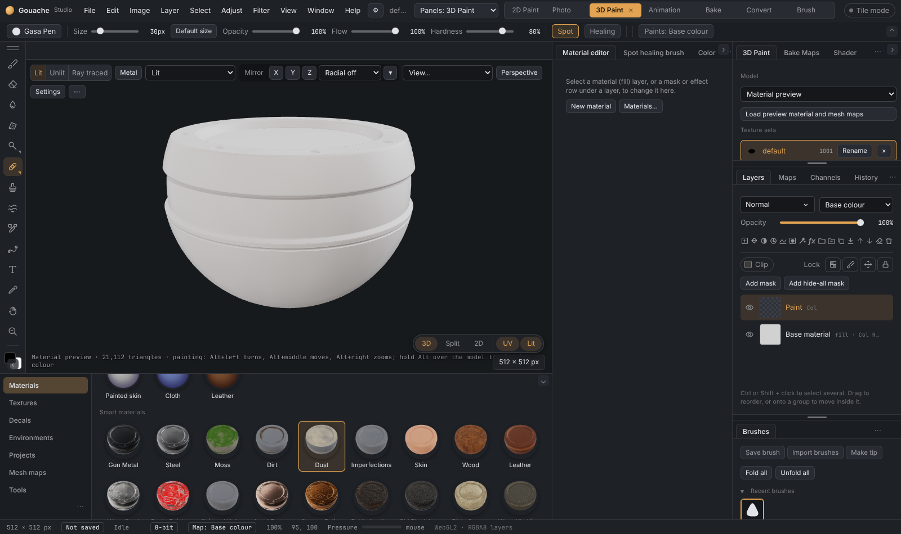

# Smart materials, smart masks and anchor points

## Smart materials
A **smart material** is a whole folder of layers saved as one: material layers, their masks with all their rows (generators, noise, mesh maps, filters…), content effects and anchors. Drop one on a model and it fits itself to that model, because its masks read the texture set's own mesh maps (curvature, AO…), like Substance Painter's.

**Using one:** open the **Materials** tab and click a tile under **Smart materials**. It arrives as a folder above the selected layer. Open the folder to change any layer or mask row; everything stays live.

**Built in:** Gun metal, Moss, Dirt, Dust, Imperfections, Skin, Steel, Wood and Leather (these work at any size), and, since 0.34, 19 richer ones built from the Library materials and the photo grunge maps: Worn Steel, Rusty Painted Metal, Chipped Yellow Paint, Aged Bronze, Copper Patina, Battle Leather, Old Black Leather, Dirty Canvas, Worn Khaki Cloth, Weathered Wood, Old Planks, Cracked Stone, Snowy Rock, Muddy Ground, Stained Concrete, Scuffed Plastic, Cracked Porcelain, Worn Carbon and Molten Rock. The first time you add one it fetches its pictures, so give it a moment.

**Your own:** right-click a folder (or a single layer) › **Save as smart material…** and give it a name. Pictures used by its layers and masks are saved with it. To change it later, edit the folder's layers, then right-click the folder › **Update smart material “name” in Materials**. The built-in ones can't be overwritten; save your own copy instead.

## Smart masks
A **smart mask** is just a mask stack, saved: the rows of a layer's mask. Click a tile under **Smart masks** to give the selected layer that mask (it replaces the mask it had).

**Built in:** Worn edges, Dirty cavities, Dusty top, Scratched and Chipped paint, plus (0.34) Scratched edges, Scuffed edges, Rust streaks, Rust pits, Heavy grime, Paint chips, Cracks, Water stains, Settled dust, Frost, Fingerprints and Dripping grime, which use the photo grunge maps.

**Your own:** right-click a layer with a mask › **Save mask as smart mask…**

Both kinds show **⤓** (export as a **.gmat** file to share) and **×** (delete) on your own tiles; **Import…** in the Materials tab brings them in.

## Built-in sets (0.95.6)

**Smart materials** added in 0.95.6:
- **Weapons and armour:** Handled Gunmetal (bright worn edges, polished grip, grime), Blued Steel (bare-steel edges, oily prints, fine rust), Battle-Worn Plate (gashes, dents and nicks, soot, rust).
- **Sci-fi:** Sci-fi Hull Paint (chipped to metal, panel grime, leaks), Anodised Aluminium (bright scratched edges, fingerprints), Glowing Trim (glow in the grooves).
- **Fantasy and characters:** Ornate Gold (tarnish in the recesses, polished highlights), Enchanted Iron (arcane glow, silvered edges), Weathered Skin (pores, sun damage, redness, grime).
- **Stylised:** Stylised Wood, Stone, Steel, Gold and Leather, using the Hand-painted look.
- **Staples:** Painted Steel Worn, Smudged Chrome, Dusty Rubber, Matte Plastic, Forged Iron, Tarnished Silver, Stained Aluminium.

**Smart masks** added in 0.95.6:
- **Wear and damage:** Battle damage, Blade scratches, Bullet nicks, Grip wear, Scorch marks, Torn coating, Gashed paint.
- **Weather and nature:** Moss in cavities, Water streaks, Sun-bleached top, Snow on top, Sand in crevices, Mud splash low, Ground dirt, Surface leaks, Dust in occlusion.
- **Stylised:** Painterly edge highlight, Top light, Hand-painted cavity shade, Colour variation patches.
- **Technical:** Height bottom to top, Ambient occlusion only, Curvature edges only, Thin parts (thickness). These read the baked mesh maps, so bake them first.

The older built-ins were updated too: their wear, dirt and dust masks now break up unevenly (Distort plus a Warp row), and their plain wear and dirt layers have a little height, so chips sit lower and grime sits higher and both catch the light.

**Mixed grunges:** the Textures panel has a **Mixed** category with 12 grunges blended from the photo grunges with the Grunge Mixer's own blend modes: Battle damage, Blade scratches, Handled wear, Bullet nicks, Panel grime, Sandblasted, Ornate tarnish, Scorch marks, Painterly breakup, Mud splash, Lichen patches and Sun bleach. Use them anywhere a grunge goes, or as a starting point in the Grunge Mixer.

## Anchor points
An **anchor point** lets masks higher up follow what you painted lower down, like Substance Painter's anchors. Paint some raised rivets or panel lines into a layer's height, and the rust, dirt or edge wear above them follows those details, even though they are not in the baked mesh maps.

1. Select the layer whose painting should be followed, click its own thumbnail, then **✦ › ⚓ Anchor point**. A blue anchor row appears under the layer; its name is the anchor's name (rename it in Properties).
2. On a layer above, click its mask thumbnail, then **✦ › From anchor** and pick the anchor. Choose what to read:
   - **Height:** raised parts white.
   - **Shape:** where the anchored layer has paint.
   - **Colour:** its brightness.
   
   **Invert** swaps black and white.
3. Generators (Edge wear, Dirt in cavities…) can also **follow an anchor**: in the generator's settings, pick the anchor under *Also follow anchor*. The generator then finds edges and cavities in the painted height as well as in the baked maps.

Everything stays live: paint more on the anchored layer and the masks above follow.

## Workshop examples

Six additional materials use the bundled library and live, editable masks: **Worn painted metal**, **Weathered leather**, **Aged wood**, **Abandoned concrete**, **Stylized armour**, and **Comic book**. Their names begin with **Workshop ·** in Materials. Matching masks are **Exposed metal**, **Leather scuffs**, **Faded wood**, **Damp recesses**, **Armour edge highlights**, and **Comic halftone**.

Bake curvature and AO for each model before applying them. Library image layers use triplanar projection, so their scale and surface detail can be adjusted without changing the UV layout. Change individual layer opacity to reduce chips, dirt, cracks or moss. The armour also works with the Toon shader for a stronger illustrated appearance; a smart material does not change the model's shader automatically.

Comic book uses an ochre base, dark ink shadows, printed dots, cream highlights and curvature-driven ink edges. Its Light and Comic shading masks remain editable: change the direction, elevation, dot density and dot size in Properties. These masks use a chosen light direction independently of the viewport's environment lighting. Comic book and Comic halftone require version 0.46.1 or later when exported and imported elsewhere.
